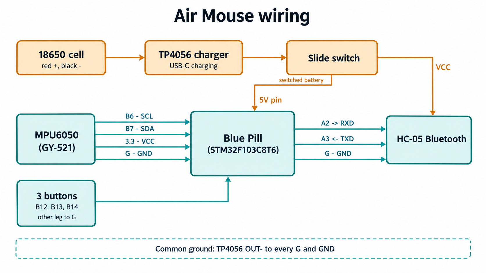

# Airmouse

A low-cost handheld motion-controlled mouse built with an STM32 Blue Pill and MPU6050.

## Introduction

An air mouse lets you move a computer cursor by waving your hand in the air instead of rolling a mouse on a desk. This project uses a gyroscope sensor to read hand motion and convert tilt and rotation into cursor movements.

## Features

- USB HID mode: Works as a standard mouse with no special drivers.
- Wireless Bluetooth mode: Transmits movement packets over Bluetooth serial to a Python receiver script.
- Mode switching: Switch between USB and Bluetooth modes using a long button press.
- Smooth control: Hardware calibration, dead zone filtering, and low-pass smoothing prevent cursor jitter.
- Three tactile buttons: Left click, right click, and a recentre / mode-switch button.

## How it works

The STM32 microcontroller samples the MPU6050 gyroscope over I2C every 10 ms. During startup, it measures and subtracts sensor bias while the board rests still. It then applies a 1.5 deg/s dead zone to eliminate resting drift and smooths readings with a low-pass filter (alpha = 0.3).

The filtered values are scaled to pixel motion. In USB mode, movements are sent directly as standard USB HID reports. In wireless mode, the board transmits a 5-byte packet over USART2 to the HC-05 module:

`[0xAA, dx, dy, buttons, checksum]`

- `0xAA`: Sync header byte.
- `dx`: Horizontal movement (-127 to 127).
- `dy`: Vertical movement (-127 to 127).
- `buttons`: Button bitmask (bit 0 = left click, bit 1 = right click).
- `checksum`: XOR sum of the first four bytes (`0xAA ^ dx ^ dy ^ buttons`).

## Hardware

The HC-05 module uses Bluetooth Classic (Serial Port Profile), not Bluetooth Low Energy (BLE).

| Component | Description |
| --- | --- |
| STM32F103C8T6 | "Blue Pill" ARM Cortex-M3 microcontroller board |
| GY-521 (MPU6050) | 6-axis gyroscope and accelerometer breakout board |
| HC-05 | Bluetooth Classic 2.0 SPP module |
| Tactile push buttons | 3 momentary buttons (left, right, recentre) |
| ST-Link V2 | SWD programmer and debugger |
| TP4056 | Single-cell Li-ion battery charger with protection |
| 18650 Li-ion battery | 3.7V rechargeable battery pack with protection board |
| Slide switch | SPDT power switch |
| Breadboard and wires | Solderless breadboard and jumper wires |

## Wiring

Connect the components to the Blue Pill as shown below:

| Module Pin | Blue Pill Pin | Description |
| --- | --- | --- |
| MPU6050 VCC | 3.3V | 3.3V power |
| MPU6050 GND | G (GND) | Ground |
| MPU6050 SCL | PB6 | I2C1 clock |
| MPU6050 SDA | PB7 | I2C1 data |
| MPU6050 AD0 | G (GND) | I2C address select (sets address to 0x68) |
| HC-05 VCC | 5V | 5V power |
| HC-05 GND | G (GND) | Ground |
| HC-05 TXD | PA3 | USART2 RX (data from HC-05) |
| HC-05 RXD | PA2 | USART2 TX (data to HC-05) |
| Left button | PB12 | Left click (other pin to GND) |
| Right button | PB13 | Right click (other pin to GND) |
| Recentre button | PB14 | Recentre / Mode switch (other pin to GND) |

Power wiring:
- Connect the 18650 battery to the B+ and B- terminals of the TP4056 module.
- Connect TP4056 OUT+ through the slide switch to the Blue Pill 5V pin and HC-05 VCC pin.
- Connect TP4056 OUT- to the Blue Pill GND pin and HC-05 GND pin to establish a common ground.

Safety:
- Never connect USB and the battery to the Blue Pill at the same time.
- Keep the slide switch turned off while charging the battery.
- Always check battery polarity with a multimeter before connecting it.



## Project structure

```
.
├── CMakeLists.txt                # Main CMake build configuration
├── CMakePresets.json             # Build presets for Debug and Release
├── STM32F103xx_FLASH.ld          # Flash linker script (CubeMX generated)
├── startup_stm32f103xb.s         # Cortex-M3 startup assembly (CubeMX generated)
├── Airmouse.ioc                  # STM32CubeMX project file
├── Core/
│   ├── Inc/
│   │   ├── airmouse.h            # Tuning parameters and debug definitions (hand-written)
│   │   ├── hc05.h                # HC-05 packet layout and declarations (hand-written)
│   │   ├── gpio.h                # GPIO pin headers (CubeMX generated)
│   │   ├── i2c.h                 # I2C peripheral header (CubeMX generated)
│   │   ├── main.h                # Main application header (CubeMX generated)
│   │   ├── stm32f1xx_hal_conf.h  # HAL library configuration (CubeMX generated)
│   │   └── stm32f1xx_it.h        # Interrupt service routine headers (CubeMX generated)
│   └── Src/
│       ├── airmouse.c            # MPU6050 logic, filtering, and main loop (hand-written)
│       ├── hc05.c                # USART2 non-blocking driver (hand-written)
│       ├── gpio.c                # GPIO initialization (CubeMX generated)
│       ├── i2c.c                 # I2C1 initialization (CubeMX generated)
│       ├── main.c                # Main loop calling airmouse handlers (CubeMX generated)
│       ├── stm32f1xx_hal_msp.c   # Peripheral MSP callbacks (CubeMX generated)
│       ├── stm32f1xx_it.c        # Interrupt handlers (CubeMX generated)
│       ├── syscalls.c            # Newlib system calls (CubeMX generated)
│       ├── sysmem.c              # Memory management stubs (CubeMX generated)
│       └── system_stm32f1xx.c    # Device clock setup (CubeMX generated)
├── Drivers/                      # STM32 HAL and CMSIS drivers (CubeMX generated)
├── Middlewares/                  # ST USB Device stack (CubeMX generated)
├── USB_DEVICE/                   # USB HID configuration and descriptors (CubeMX generated)
│   ├── App/                      # USB device callbacks (CubeMX generated)
│   └── Target/                   # USB hardware configuration (CubeMX generated)
├── cmake/                        # Toolchain and CubeMX helper files
├── docs/                         # Documentation assets and diagrams
│   └── wiring.png                # Wiring connection diagram placeholder
└── host/                         # Wireless desktop host application (hand-written)
    ├── airmouse_host.py          # Python receiver for HC-05 serial packets (hand-written)
    └── requirements.txt          # Python dependencies (hand-written)
```

## Build and flash (macOS)

Install the required tools: Arm GNU Toolchain (`arm-none-eabi-gcc`), CMake, Ninja, and OpenOCD.

Connect your ST-Link V2 programmer to the Blue Pill:
- ST-Link SWDIO to Blue Pill SWDIO
- ST-Link SWCLK to Blue Pill SWCLK
- ST-Link GND to Blue Pill GND

Run these commands to build and flash the firmware:

```bash
cmake --preset Debug
cmake --build --preset Debug
openocd -f interface/stlink.cfg -f target/stm32f1x.cfg -c "program build/Debug/Airmouse.elf verify reset exit"
```

The same build and flash steps work on Linux and Windows when the tools are installed in your PATH.

## How to use it

### USB mode
1. Plug the Blue Pill into your computer using a micro-USB data cable.
2. Keep the board resting still for 1.5 seconds while it calibrates gyro bias.
3. Short-press B14 to enable mouse movement (the onboard PC13 LED will turn on).

### Wireless mode
1. Power the board using the battery pack or an external USB charger.
2. Pair the HC-05 module in your computer's Bluetooth settings (PIN: `1234` or `0000`).
3. Locate your serial port and run the host script.

### Mode switch
- Long-press B14 (hold for 1.5 seconds or more) to switch between USB and wireless modes.
- The onboard LED blinks 3 times for USB mode, or 2 times for wireless mode.
- Short-press B14 (under 0.8 seconds) to recalibrate gyro bias and toggle cursor movement on or off.

### Running the host script

The host script receives serial packets from the HC-05 and controls the desktop cursor across macOS, Windows, and Linux.

1. Install dependencies:
```bash
pip install -r host/requirements.txt
```

2. Test packet reception in dry-run mode (does not move cursor):
```bash
python3 host/airmouse_host.py --dry-run
```

3. Run in live mode to control the cursor:
```bash
python3 host/airmouse_host.py
```

Command-line options:
- `--port`: Serial port path. Defaults to auto-detecting `/dev/cu.HC-05*` on macOS.
- `--scale`: Sensitivity multiplier (default: 1.0).
- `--dry-run`: Prints packet values without moving the mouse.

Serial port names differ by operating system:
- macOS: Uses `/dev/cu.*` (for example `/dev/cu.HC-05`). Do not use `/dev/tty.*`.
- Windows: Uses a COM port (such as `COM4`). In Bluetooth settings, check the Outgoing COM port.
- Linux: Uses `/dev/rfcomm0` (after binding with `rfcomm bind`) or `/dev/ttyUSB0`.

On macOS, you must grant Accessibility permission to your Terminal or IDE (System Settings -> Privacy & Security -> Accessibility) so PyAutoGUI can control the cursor.

## Settings you can tune

You can modify mouse behaviour by editing `#define` values in `Core/Inc/airmouse.h`:

| Define | Default | Description |
| --- | --- | --- |
| `X_SOURCE`, `Y_SOURCE` | `gz`, `gx` | Gyroscope axis mapped to horizontal (X) and vertical (Y) cursor movement |
| `X_SIGN`, `Y_SIGN` | `-1`, `1` | Inverts movement direction on each axis (+1 or -1) |
| `SENSITIVITY` | `0.5f` | Cursor speed multiplier |
| `DEADZONE_DPS` | `1.5f` | Angular velocity threshold (deg/s) below which motion is ignored |
| `LPF_ALPHA` | `0.3f` | Low-pass filter smoothing factor (0.0 to 1.0; lower is smoother) |
| `PACKET_PERIOD_MS` | `20` | Transmission interval in milliseconds for wireless packets (50 Hz) |
| `AUTO_DETECT_MODE` | `1` | Automatically select USB mode if plugged in at boot, else wireless mode |

## Troubleshooting

1. Cursor moves in the wrong direction: Change `X_SIGN` or `Y_SIGN` in `Core/Inc/airmouse.h` from `1` to `-1` (or `-1` to `1`).
2. Cursor drifts across the screen when resting: Increase `DEADZONE_DPS` in `Core/Inc/airmouse.h`, or place the board flat and short-press B14 to recalibrate.
3. Computer does not recognize USB device: Check that your USB cable has data lines. Power-only charging cables will not work.
4. HC-05 module cannot be paired or found: Check the module LED. A rapid blink means it is waiting to pair. Ensure no other device is currently connected to it.
5. Mouse does not move in wireless mode: Watch the LED blinks when long-pressing B14 to ensure it is in wireless mode (2 blinks), then short-press B14 once to enable movement.
6. macOS does not list the HC-05 serial port: Some macOS versions fail to bind classic Bluetooth SPP serial devices. Use USB mode or connect via a Windows or Linux machine.

## Known limitations and future work

- Battery runtime has not been measured yet.
- The HC-05 uses Bluetooth Classic (serial SPP), which requires the Python host script. A native Bluetooth Low Energy (BLE HID) module would work directly without host software.
- Bluetooth Classic pairing on macOS can fail on some Mac models.
- Uses gyroscope data only; no accelerometer-based tilt correction is implemented.


## Support

- ⭐ **Star the project**: If this helped you or inspired your own build, consider giving it a star!
- 🐞 **Questions & issues**: Run into a problem or have a question? Open an issue on GitHub.
- 🤝 **Contribute**: Pull requests, bug fixes, and feature suggestions are always welcome.

